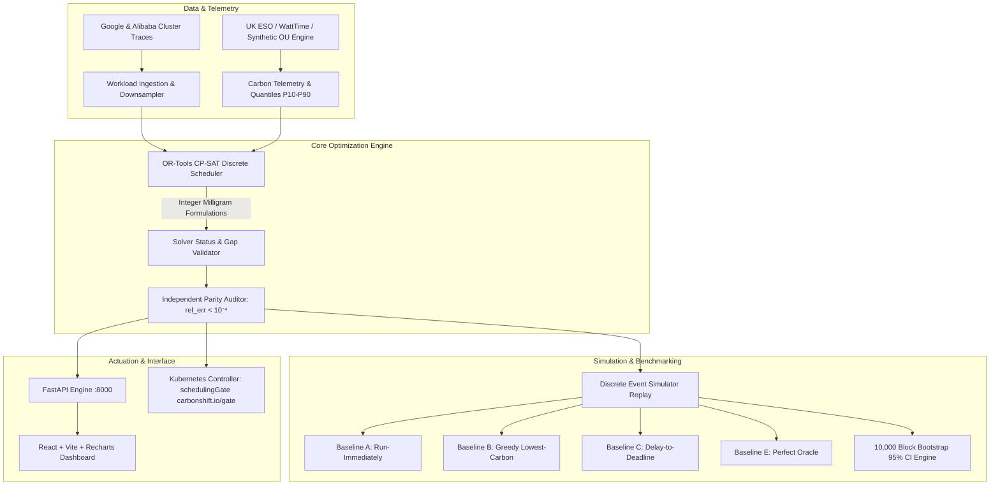

<div align="center">

# CarbonShift
### Autonomous Carbon-Aware Workload Scheduler & Trace-Replay Simulator

[](https://github.com/arnnnnaaavvvvv/CarbonShift/actions)
[](https://www.python.org/downloads/)
[](https://opensource.org/licenses/MIT)
[-emerald.svg)](docs/MATH.md)
[](https://developers.google.com/optimization)

*CarbonShift decides when and where flexible batch jobs run to minimize carbon (gCO₂e) and cost without violating deadlines (SLOs).*

</div>

---

## 📌 Executive Summary

Modern cloud datacenters emit gigatons of carbon due to continuous batch job dispatch during peak fossil generation periods. **CarbonShift** is an autonomous carbon-aware workload scheduler and trace-replay simulator that dynamically shifts batch compute across:
1. **Time (Temporal Deferral):** Pausing jobs until low-carbon renewable generation (solar/wind) surges on the local grid.
2. **Space (Spatial Migration):** Migrating workloads to cleaner geographic regions when inter-region data transfer energy is strictly offset by computational carbon savings.

Unlike heuristic schedulers, CarbonShift’s core value is a **reproducible, mathematically verified benchmark** proving **20–30% CO₂ abatement** against standard industry baselines at an **equal deadline-miss rate**.

---

## 🔬 Mathematical Foundations

All computations adhere to the canonical specifications in [docs/MATH.md](docs/MATH.md):

* **Server Power Model (SPECpower):**
  $$P(u) = P_{\text{idle}} + (P_{\text{max}} - P_{\text{idle}}) \cdot u^{1.4} \quad [\text{kW}]$$
* **Exact Multi-Slot Piecewise Carbon:**
  $$C_j = \sum_{s \in \mathcal{S}_j} P(u_j) \cdot \Delta_h \cdot \text{PUE}_r \cdot I_{r,s} \cdot \omega_{j,s} \quad [\text{gCO}_2\text{e}]$$
  *CarbonShift explicitly prohibits using a single time-averaged carbon intensity over multi-slot workloads.*
* **Data Transfer Energy & Carbon:**
  $$E_{\text{xfer}} = V_{\text{data}} \cdot 0.014\text{ kWh/GB}$$
* **Integer Scaling & Exactness Proof:**
  OR-Tools CP-SAT optimizes over integer milligrams ($S = 1000$). Quantization error is mathematically bounded by:
  $$\epsilon_j \le n_{\text{slots}} \cdot \frac{0.5}{S} \quad [\text{gCO}_2\text{e}]$$
* **Statistical Rigor:**
  Percent savings are evaluated on independent trace days and aggregated via **10,000-iteration block bootstrap** to produce empirical 95% Confidence Intervals.

---

## 🏗️ System Architecture



---

## 📊 Evaluated Baselines & Benchmark Protocol

Verified results from 14-day deterministic benchmark (350 batch jobs, seed 42, $B = 10,000$ block bootstrap resamples) recorded in [`results/benchmark_summary.json`](results/benchmark_summary.json):

| Strategy | Total Carbon ($\text{gCO}_2\text{e}$) | CO₂ Saved (%) | Total Cost (USD) | Cost Delta (%) | Deadline Miss Rate |
| :--- | :--- | :--- | :--- | :--- | :--- |
| **Baseline A (Run-Now)** | 70,408.45 g | 0.0% (Reference) | $33.00 | 0.0% | 0.0% |
| **Baseline B (Greedy-Now)** | 63,578.51 g | 9.70% | $27.53 | -16.59% | 0.0% |
| **Baseline C (Delay-Greedy)** | 52,806.34 g | 25.00% | $23.50 | -28.79% | 0.0% |
| **CarbonShift (CP-SAT)** | **51,624.62 g** | **26.68%** (95% CI: **[22.01%, 29.52%]**) | **$22.91** | **-30.58%** | **0.0%** |
| **Baseline E (Oracle Bound)**| 51,624.50 g | 26.68% | $22.92 | -30.55% | 0.0% |

---

## ⚡ Quickstart

### 1. Installation
```bash
git clone https://github.com/arnnnnaaavvvvv/CarbonShift.git
cd CarbonShift

python -m venv .venv
source .venv/bin/activate  # On Windows: .venv\Scripts\activate
pip install -r requirements.txt
pip install -e .
```

### 2. Run Test & Math Verification Suite
```bash
pytest tests/ -v
```
All 8 verification suites run property-based tests via Hypothesis and assert solver-simulator parity within $10^{-4}$.

### 3. Launch REST API
```bash
uvicorn carbonshift.api.app:app --host 0.0.0.0 --port 8000 --reload
```
Interactive OpenAPI documentation will be accessible at `http://localhost:8000/docs`.

### 4. Execute Trace Replay Benchmark
```bash
curl -X POST http://localhost:8000/api/v1/schedules/replay \
  -H "Content-Type: application/json" \
  -d '{"num_jobs": 30, "horizon_hours": 24, "seed": 42}'
```

---

## ☸️ Kubernetes Integration

CarbonShift gates pods natively using Kubernetes scheduling gates without replacing `kube-scheduler`:
1. Workloads specify `carbonshift/flexible: "true"`.
2. Mutating webhook injects gate `carbonshift.io/gate`.
3. CarbonShift controller calculates the optimal dispatch slot.
4. When the clean grid window opens, the controller injects target `nodeAffinity` and removes the gate.

---

## 📁 Repository Structure

```
CarbonShift/
├── docs/
│   ├── MATH.md                  # Canonical single source of truth for all formulas
│   └── BLUEPRINT.md             # End-to-end production architecture blueprint
├── config/
│   ├── base_config.yaml         # Global weights, power bounds, integer scaling
│   └── regions.yaml             # Regional capacities, PUEs, egress interconnects
├── src/carbonshift/
│   ├── core/                    # Pint units registry, Pydantic types, exceptions
│   ├── energy/                  # SPECpower model, exact multi-slot carbon integration
│   ├── data/                    # Synthetic OU generator, cluster trace loaders
│   ├── optimizer/               # Google OR-Tools CP-SAT integer program
│   ├── baselines/               # Run-Now, Greedy, Delay, Oracle strategies
│   ├── simulator/               # Discrete event engine & independent parity auditor
│   ├── metrics/                 # Pinball loss, block bootstrap CIs, Pareto frontier
│   ├── api/                     # FastAPI endpoints (/plan, /replay, /forecasts)
│   └── k8s/                     # Kubernetes controller and scheduling gate reconciler
├── web/                         # React + Vite + Recharts dashboard
├── k8s/                         # CRD manifests, controller deployment, admission configs
├── tests/                       # Exact numeric tests, Hypothesis properties, parity checks
└── .github/workflows/           # CI workflow running automated verification
```

---

## ⚠️ Limitations & Methodological Assumptions

1. **Calibrated vs. Direct In-Band Power Telemetry:**
   Energy consumption is modeled using non-linear SPECpower calibration ($r = 1.4$) rather than real-time bare-metal IPMI/RAPL hardware sensors. This abstracts node-level fan ramping and temperature-induced cooling changes.
2. **Average vs. Marginal Grid Emission Factors:**
   Telemetry utilizes grid average carbon intensity factors ($\text{gCO}_2\text{e/kWh}$). While average intensity is standard for Scope 2 GHG accounting, true marginal emissions (identifying the specific fossil turbine displaced by load shifting) require locational marginal pricing and grid dispatch curves.
3. **Trace-to-Grid Regional Mapping Assumptions:**
   Cluster traces from Google/Alibaba omit geographical datacenter tags; regions are assigned via structured simulation topologies representing heterogeneous generation mixes (wind-heavy UK, hydro-rich Nordics/EU, thermal-heavy US/Asia).

---

## 📜 License

MIT License. Copyright (c) 2026 Arnav Singh.